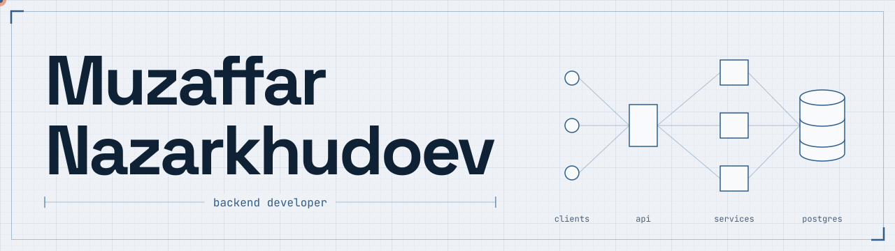
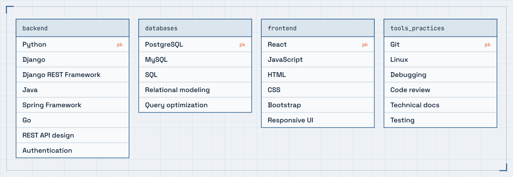

<a href="https://mnazarkhudoev.pages.dev/">
  <picture>
    <source media="(prefers-color-scheme: dark)" srcset="assets/banner-dark.svg">
    
  </picture>
</a>

I build the parts of software nobody sees: APIs, data models and the queries that keep them fast. Mostly Python, Django and PostgreSQL, with Java and Spring when the job calls for it. Currently learning Go.

Based in Dushanbe, Tajikistan, and open to remote work.

**[Resume site](https://mnazarkhudoev.pages.dev/)** · **[Download CV](https://mnazarkhudoev.pages.dev/Muzaffar_Nazarkhudoev.pdf)** · **[Get in touch](https://mnazarkhudoev.pages.dev/#contact)**

## Stack

<picture>
  <source media="(prefers-color-scheme: dark)" srcset="assets/stack-dark.svg">
  
</picture>

## Experience

experience   3 years, backend-focused full-stack
domains      healthcare, logistics, warehouse and inventory
work         REST APIs, authentication, data modelling, query tuning
teams        remote work for a US client, university development teams

